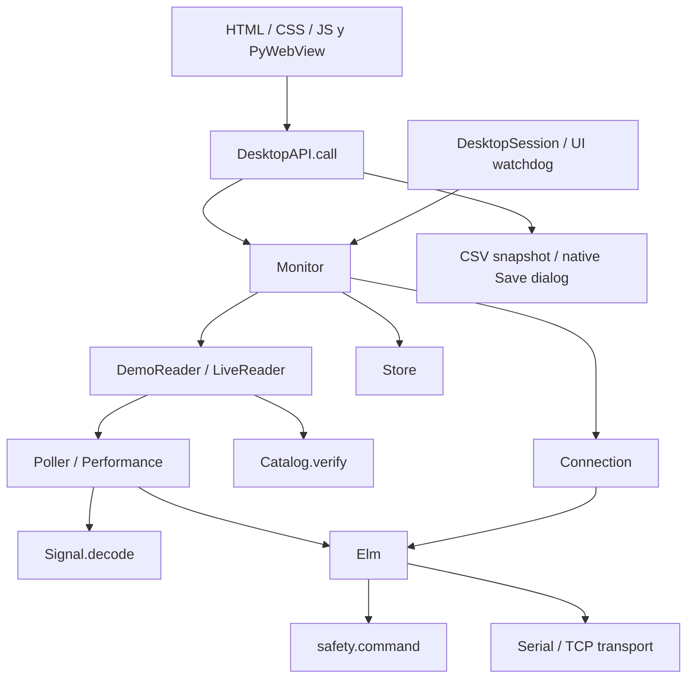

# Архітектура Renmon

Renmon — локальний desktop-монітор параметрів ECU на Python + PyWebView. HTTP-сервера, localhost API та браузерного режиму немає. HTML/CSS/JavaScript збережені; UI спілкується з Python через нативний міст PyWebView. На macOS використовується WKWebView, на Windows — WebView2.

## Межі модулів: vertical slices

| Модуль | Власна відповідальність | Залежності |
|---|---|---|
| `features/desktop` | Самодостатній HTML, обмежений bridge, watchdog UI, системний CSV-діалог | monitoring, history |
| `features/ecu` | Каталог X91, ідентифікація 2180, профілі, формули та декодування | safety |
| `features/connection` | Володіння serial-портом, автопідключення, перелік портів, Bluetooth helper | elm, transport |
| `features/monitoring` | Start/Stop, зміна параметрів, demo/live reader, цикл і Performance | ecu, connection, history |
| `features/history` | SQLite-журнал і представлення CSV | стандартна бібліотека |
| `elm.py`, `transport.py`, `safety.py` | Протокол, байтові транспорти та політика дозволених команд | pyserial / socket для ручного TCP CLI |
| `desktop.py` | Точка композиції, перевірка WebView2, створення вікна, завершення | features/desktop, monitoring |
| `cli.py` | Консольні інструменти та команда desktop | feature-модулі / ELM |
| `clip`, `tools` | Офлайн-імпорт CLIP і підготовка збірки | локальні файли |

Старі `profile.py`, `connection.py`, `catalog.py`, `decode.py`, `performance.py`, `store.py`, `serial_ports.py` залишаються сумісними експортами. Реалізація живе у `features`. HTTP-модуль `web.py` видалений. Нижчі модулі не імпортують desktop entrypoint або CLI.



## Завантаження UI без прихованого сервера

`tools/build_ui.mjs` збирає ES-модулі через esbuild у `renmon/ui.bundle.js`. `features/desktop/assets.py` вставляє CSS і JS у HTML-рядок. PyWebView отримує `html=...`, а не локальний URL; `http_server=False`. Це важливо: передавання локального шляху як URL могло б запустити вбудований сервер PyWebView.

Документ не містить зовнішніх ресурсів, посилань на навігацію або HTTP fetch. CSP забороняє мережеві запити (`connect-src 'none'`), форми й зовнішні ресурси; inline/eval потрібні для локального bundle та ін'єкції нативного мосту. Завантаження файлів через браузер вимкнене. Node.js потрібен лише розробнику/збирачу, а не користувачу готового застосунку.

## Контракт bridge

`shared/api.js` чекає `pywebviewready`, потім викликає `window.pywebview.api.call(action, data)`.

Дозволені дії: `catalog`, `ports`, `state`, `start`, `stop`, `profile`, `detect`, `signals`, `adapter`, `export`. Відповідь — `{ok: true, result: ...}` або `{ok: false, error: ...}`. Перевіряються типи та межа JSON-параметрів 8192 байти. Немає доступу до довільної Python-функції, команди ELM або шляху файла. Внутрішні посилання API мають приватні імена.

`export` бере snapshot і відкриває системний Save dialog. Шлях повертає ОС, а не JavaScript. Одночасно можна відкрити лише один експортний діалог. Скасування не створює файл. Підтримані повернення PyWebView як рядок (macOS) і як послідовність шляхів (Windows).

## Життєвий цикл і втрата UI

Одне вікно володіє одним `DesktopSession` та одним `Monitor`.

- `state` оновлює heartbeat. Окремий watchdog перевіряє його кожні 0.5 с.
- Якщо heartbeat відсутній понад 15 с, сесія атомарно стає закритою. Відхиляються нові start/adapter/інші bridge-запити; повернення старого UI не відновлює з'єднання автоматично. Потрібен перезапуск.
- Watchdog працює навіть до Start: увімкнене idle-автопідключення не залишається без UI.
- Закриття вікна (`window.events.closed`) і `finally` головного entrypoint викликають ідемпотентний cleanup.
- Cleanup спочатку забороняє нові фонові спроби Connection, виставляє Stop, чекає завершення поточного запиту/worker та закриває serial-порт. Миттєво перервати системний serial I/O не гарантується: можливе очікування timeout поточного запиту.
- Припиняються запити ECU і keepalive; окремої команди скидання чи «розриву CAN-з'єднання» немає.

`Стоп` у відкритому працездатному UI має іншу семантику: при вимкненому автопідключенні звільняє порт, при увімкненому — залишає адаптер готовим. Автопідключення типово вимкнене; вибір порту сам по собі його не відкриває. `begin` у ручному режимі робить одну спробу після Start/Detect, без helper/settle і фонових повторів. За `auto_connect=True` та непорожнього порту діють повтори раз на 3 с й idle ATI. Під час активного читання фоновий ATI не втручається.

## Моніторинг і конкурентність

`StartRequest` перевіряє режим, унікальні коди, інтервал 0.1–10 с, сесію та Performance. Monitor захоплює профіль на весь сеанс. Desktop UI не передає вибір діагностичної сесії: для читання та визначення профілю діє стандартне значення без зміни сесії. Коди копіюються на початку циклу: зміни застосовуються з наступного циклу. Змінювати профіль під час читання заборонено.

`Monitor.lock` захищає короткі переходи стану. Serial I/O виконується лише під `Connection.lock`, без state-lock. Idle-операції profile/detect/adapter резервуються через `operation`. Визначення ECU не блокує читання state, heartbeat або Stop.

`LiveReader` після кожного нового підключення налаштовує ELM, за потреби відкриває дозволену сесію і перевіряє ECU через 2180. Poller читає один раз кожен унікальний DID; Performance може об'єднати до трьох DID після перевірки довжини окремих відповідей. Некоректна групова відповідь вимикає об'єднання для цього з'єднання. Формули декодування не залежать від способу доставки UI.

Цикли не накладаються; інтервал — бюджет циклу. UI показує фактичний час та попередження. SQLite й UI використовують однаковий timestamp; метадані сигналів записуються лише при зміні набору. Три цикли без значень зупиняють читання.

## Frontend

`app.js` — точка композиції модулів із callbacks/getters, без глобальних змінних у window. `features/parameters` володіє пошуком і бібліотекою, `tiles` — плитками та порядком, `chart` — canvas і tooltip, `monitoring/timing` — швидкістю/попередженням, `connection/ports` — вибором портів. `shared` містить bridge-клієнт, DOM/форматування та layout. Feature-модулі не імпортують app.js або один одного.

Вибрані датчики й серії графіка — окремі набори. Прибирання серії не скорочує ECU-запити. UI показує hPa як mbar без зміни числа; bar зберігається. Журнал зберігає вихідні дані профілю.

До 700 px `shared/layout.js` перетворює сайдбар на початково закриту модальну панель із затемненням, утриманням фокуса та закриттям через Escape. Desktop-налаштування згортання зберігається окремо. На телефонах плитки розташовані у дві колонки (до 359 px — в одну), кнопки мають області натискання від 44 px, а графік підтримує Pointer Events для миші й дотику. Повноекранні панелі враховують динамічну висоту та safe area. Це адаптація UI, а не реалізація мобільного транспорту чи Android-оболонки.

## Безпека і перевірки

`safety.command` перевіряється перед транспортом. Дозволені конкретні AT, сесії/keepalive, точний 2180 і читання 22. Немає записів, routine-control, очищення помилок або сканування адрес. CLI probe лишається ручним інструментом без автоматичного 2180-підбору; політика команд спільна.

```sh
python -m pip install -e '.[desktop,dev,build]'
npm ci
npm run build
python tools/check.py
python -m renmon.desktop
python packaging/build_portable.py
```

Quality checks включають Ruff, ESLint, Prettier, перевірку актуальності bundle, unit/integration тести та POSIX ELM-емулятор. Desktop-тести перевіряють заборону socket bind, обмежений bridge, cleanup, heartbeat/watchdog та CSV. Фізичний ECU і native Windows потребують окремої перевірки. Windows збирається на Windows, macOS — на macOS; готовий portable не потребує Python/Node.

## Android

Мобільна оболонка та платформні адаптери описані в [ANDROID.uk.md](ANDROID.uk.md). Ядро Monitor/ELM спільне; Connection приймає фабрику serial або Android RFCOMM транспорту.

## Плитки, порівняння та теми

Кожна плитка має два режими: значення/статус і власний часовий графік. Обидва використовують ті самі зібрані samples — перемикання вигляду не змінює ECU-опитування. Окремий `features/chart/series.js` вибирає серії спільного графіка лише серед активних датчиків. `shared/time-series.js` малює як локальні, так і спільні графіки, зберігаючи ступінчасте відображення статусів.

`shared/fullscreen.js` керує стеком розгорнутих панелей у межах вікна/WebView: можна розгорнути плитку всередині групи й повернутися до групи. Фон стає inert, фокус утримується на активній панелі, Escape закриває верхній рівень. DOM плиток не пересоздається при кожному циклі читання.

`shared/theme.js` зберігає вибір теми в localStorage; режим плиток також зберігається локально. Native WebView використовує постійне сховище; мережеві запити й локальний HTTP-сервер залишаються вимкненими. CSS-змінні задають контрастні кольори, canvas отримує кольори сітки та підписів із поточної теми.


### Діагностика підключення (0.1.2)

macOS Bluetooth helper лише допомагає встановити ACL-з’єднання. Його стан або таймаут не блокують відкриття вибраного serial/SPP-порту. Після відкриття одразу надсилається адаптерна команда ATI; у простої вона підтримує зв’язок раз на 3 секунди, без запитів ECU. Під час активного читання додатковий ATI не надсилається. UI показує номер спроби. `logs/desktop.log` містить час спроб, результат helper, помилки та ідентифікацію адаптера; журнал обмежений 2 MB із трьома резервними файлами.

Для індексованих CAF1-відповідей ELM враховується оголошена ISO-TP-довжина: заповнення останнього повного CAN-кадру відкидається лише за узгодженої довжини. Без явної довжини зайві байти залишаються помилкою. При відмові Performance журнал зберігає запитані DID, очікувані довжини й сиру відповідь ELM. Після відмови зберігається перехід до окремих запитів без негайного повтору.


### Частоти датчиків та анімація (0.1.3)

`features/monitoring/cadence.py` вибирає DID для кожного базового циклу. Множники 1, 2, 3, 5, 10 перевіряються на backend. Перший запит, додавання датчика та зміна частоти виконуються в найближчому циклі; повтори — через обрану кількість виконаних циклів. Якщо запит затримався, пропущені часові інтервали не накопичуються в чергу. Для спільного DID береться найменший множник. Перепідключення скидає розклад. Дія bridge `cadence` змінює один множник під час сеансу. Demo та Live використовують один планувальник.

Samples, SQLite та CSV містять лише фактично опитані параметри. Плитки знаходять останнє вимірювання свого параметра, а графіки пропускають цикли без його опитування, розриваючи лінію на помилці. Кінець часового вікна відповідає останньому успішному вимірюванню серед серій на графіку. Верхню межу кожної серії задає максимум її видимих вимірювань.
